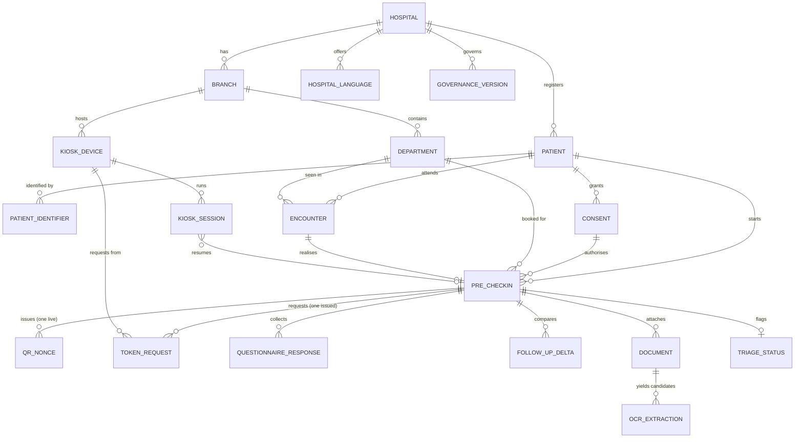

# Data model

Generated by `infra/migrations/*.sql`. This document explains the shape and the reasoning;
the migrations are authoritative.

## Entity relationships

`AUDIT_EVENT` and `INTEGRATION_OUTBOX` deliberately have no foreign keys. The audit trail
must survive the deletion of anything it describes, and an outbox message must remain
deliverable even if its originating row is later purged under a retention policy.

## Migrations

| File                                  | Contents                                                                          |
| ------------------------------------- | --------------------------------------------------------------------------------- |
| `0001_extensions_and_enums.sql`       | `pgcrypto`, `pg_trgm`, `set_updated_at()`, `bump_row_version()`, 21 enum types    |
| `0002_facility_and_governance.sql`    | hospital, branch, department, hospital_language, kiosk_device, governance_version |
| `0003_patient_and_consent.sql`        | patient, patient_identifier, consent                                              |
| `0004_encounter_precheckin_token.sql` | encounter, pre_checkin, kiosk_session, qr_nonce, token_request                    |
| `0005_clinical_intake.sql`            | questionnaire_response, follow_up_delta, document, ocr_extraction, triage_status  |
| `0006_audit_and_outbox.sql`           | audit_event, integration_outbox                                                   |

## Constraints that carry safety properties

These are database constraints rather than application checks, because application checks
race and a race here means a patient gets a second hospital token or a stolen QR works twice.

| Constraint                                        | Guarantees                                                                                                                                |
| ------------------------------------------------- | ----------------------------------------------------------------------------------------------------------------------------------------- |
| `token_request.idempotency_key` UNIQUE            | A retry, a double tap and a reconnect all derive `<kioskCode>-<preCheckinId>` and collapse into one request.                              |
| `token_request_one_issued_per_precheckin`         | At most one ISSUED token per visit, ever — even if a second idempotency key were somehow generated.                                       |
| `token_request_issued_has_token`                  | ISSUED implies a token actually exists. State and data cannot disagree.                                                                   |
| `qr_nonce.nonce` UNIQUE + conditional consume     | A QR is consumable exactly once. Concurrent scans serialise on the row; one wins.                                                         |
| `qr_nonce_one_live_per_precheckin`                | Only one live QR per visit, so a reissue cannot leave an older screenshot usable.                                                         |
| `consent_has_data_category`                       | A consent must cover at least one named category. Uses `cardinality()`, not `array_length()`, which returns NULL for `{}` and would pass. |
| `consent_validity_window`                         | `valid_until > captured_at`. A consent cannot be backdated into invalidity.                                                               |
| `consent_revoked_state`                           | REVOKED implies a withdrawal timestamp.                                                                                                   |
| `kiosk_session_ended_is_wiped`                    | A session cannot be recorded as EXITED or EXPIRED unless the secure wipe ran.                                                             |
| `document_stored_is_scanned`                      | A document is only STORED once it has cleared a malware scan.                                                                             |
| `audit_event_no_update` / `audit_event_no_delete` | The audit trail is append-only in the database, so a compromised service account cannot erase its own tracks.                             |
| `audit_break_glass_needs_reason`                  | Emergency override always states why.                                                                                                     |
| `governance_version_one_published`                | One published version of a content key per hospital at a time.                                                                            |
| `triage_alert_names_a_rule`                       | An internal alert always names the deterministic rule that fired — never a model's opinion.                                               |

## Conventions

- **UUID primary keys** everywhere except `audit_event`, which uses `bigserial` because it
  is append-only and ordered. Internal ids are never guessable sequences.
- **`version` column with a trigger** on every mutable entity. Writers pass their observed
  version in the `WHERE` clause, so a stale read cannot silently overwrite a concurrent change.
- **`updated_at` by trigger**, never by the application.
- **Documents live in object storage.** PostgreSQL holds the object key, the SHA-256 of the
  original bytes and metadata. A test asserts no `bytea` column exists anywhere.
- **Derived data sits beside the original, never on top of it.** `ocr_extraction` is a
  separate table from `document`; nothing machine-produced can be mistaken for a verified record.
- **Provenance is mandatory.** Every `questionnaire_response` and `follow_up_delta` row
  carries a `provenance_source`.

## Enum parity

PostgreSQL enum types mirror `packages/api_contracts/src/enums.ts`. `test/schema-parity.int-spec.ts`
asserts both directions and the label ordering. Without it, a row could hold a state the
state machine has never heard of, and the transition guard would be policing a graph that
does not describe the data.

One naming wrinkle: the enum is `triage_status_kind`, not `triage_status`, because a table
of that name already creates a composite type of the same name.

## Transaction policy

Consent capture, arrival confirmation and token state changes run in **SERIALIZABLE**
transactions (`src/db/transaction.ts`). They are read-modify-write sequences whose
correctness depends on no other session interleaving: at READ COMMITTED, two concurrent
kiosk scans could each read an unconsumed nonce before either wrote.

`withSerializableRetry` retries only on serialization failure (`40001`) and deadlock
(`40P01`). A business-rule rejection — an already-consumed nonce, an already-issued token —
is never retried, because retrying it would be an attempt to get a different answer to a
question the database has already settled.

## Reading enum arrays

`consent.data_categories` is an array of a user-defined enum. `pg` keys its result parsers
by OID, and a user-defined enum receives a dynamic OID at `CREATE TYPE` time, so its array
has no built-in parser and comes back as the raw literal `{demographics,clinical-history}`.
`registerEnumArrayParsers()` resolves those OIDs at startup and installs a parser. Tests
call it too, so they exercise the real read path.
